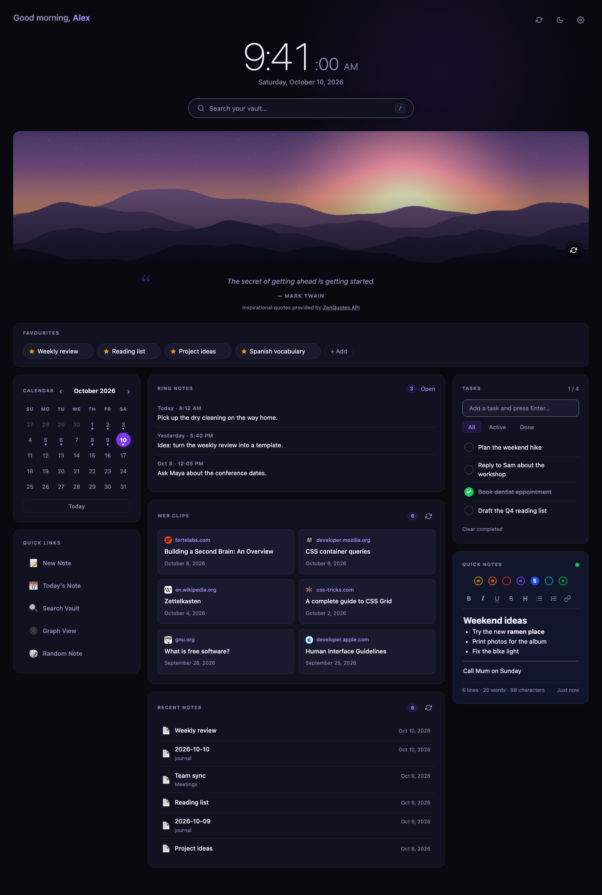
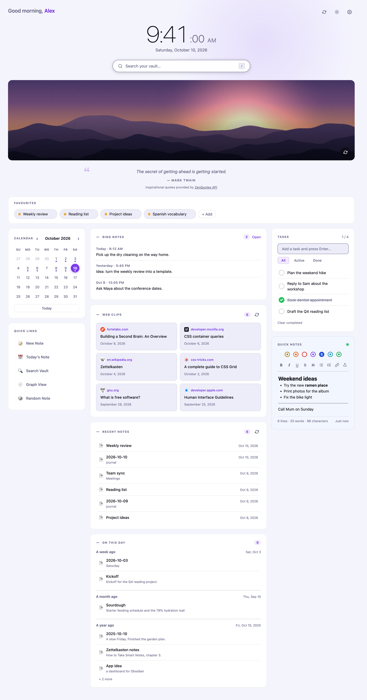
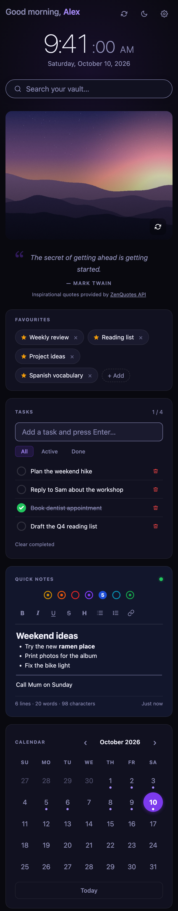
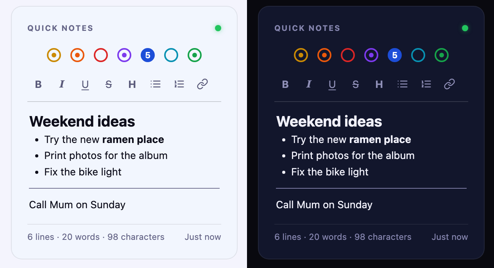
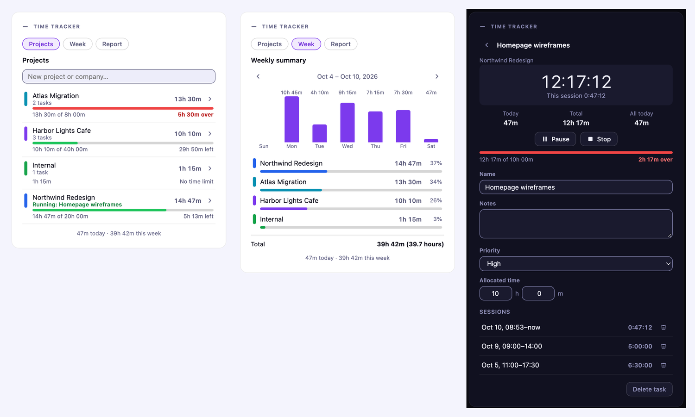
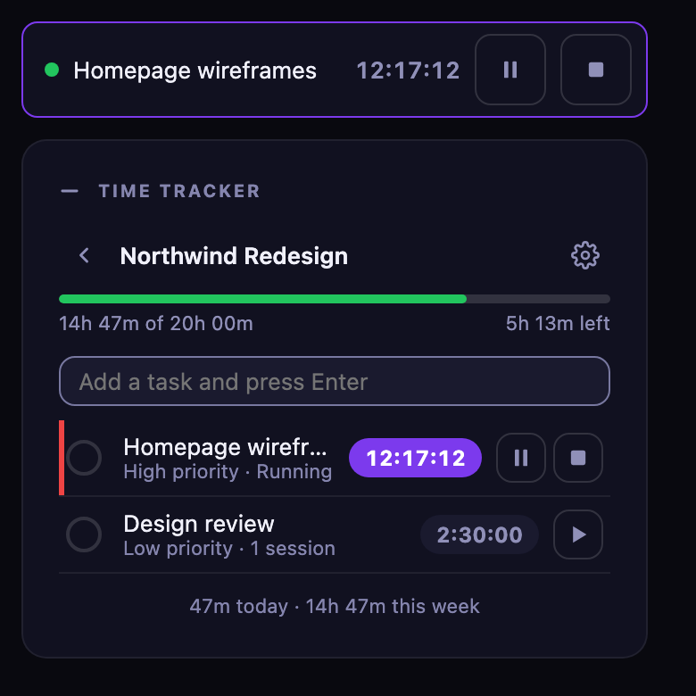
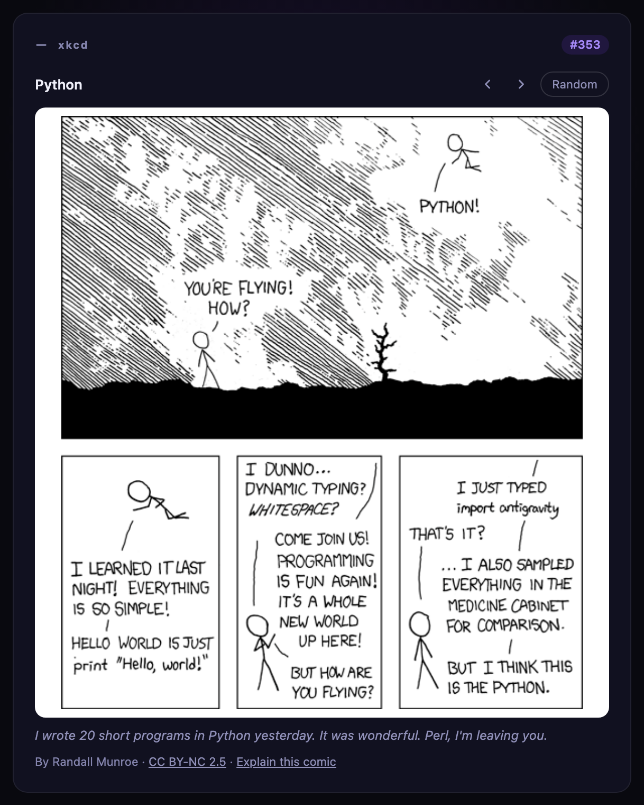

# Genkan

Genkan (玄関) is the entryway of a Japanese home: the place you step in. This plugin is the entryway to your vault, a dashboard homepage for Obsidian that works on desktop, iPhone and iPad.

- **Clock, greeting and date**, with 12 or 24 hour time
- **Search** your whole vault from the homepage (press `/` to focus it)
- **Favourites**: one-click chips for the notes you open most
- **Tasks** and **seven quick notes** (like Tot): a small rich-text editor, synced with the rest of your vault, with export to a Markdown file
- **Calendar** that opens (or creates) your daily notes
- **Web clips** from the Obsidian Web Clipper and your **recent notes**
- **Quick links** to commands, notes or web pages
- Cards in the middle column that fold down to their title
- **Arrange cards**: drag the cards into the order and columns you want, and share the layout with your other devices
- **On this day**: an optional card with notes from this date a week, a month and a year ago
- **Time tracker**: an optional card for timing work on projects and tasks, with time allocations, a weekly summary, a running timer in the status bar or at the top of the dashboard on a phone, and CSV, Excel or PDF reports
- **xkcd**: an optional card with one [xkcd](https://xkcd.com/) comic a day, the same one on all your devices
- **Vault stats**: an optional card with a 12-week heatmap of the days you wrote, your streak, counts of notes, orphan notes, unresolved links and open tasks, and your top tags
- **Ring notes**: an optional card for voice notes from a Pebble Index ring
- A photo of the day and a daily quote (both optional)

It reads and writes your vault directly through Obsidian's own API. There is no server, no account and no API key required.

## Screenshots

Dark and light themes (the dashboard follows Obsidian's theme by default):





On a phone it becomes a single column with tasks and the quick notes first:



The quick notes card, in light and dark: seven notes, one per colored dot, with formatting as you type, an export button at the end of the toolbar, and a footer of counts and the last-saved time.



The screenshots use sample data, with the optional Ring notes and On this day cards turned on.

The optional Time tracker card: the project list with how much of each budget is left, the weekly summary, and a task with its running timer.



On a phone or tablet, which have no status bar, a running timer sits in a bar across the top of the dashboard, with pause and stop buttons, while you work in the card below it.



## Install

Genkan needs Obsidian 1.4.0 or newer.

**From the Community plugins page (recommended):** in Obsidian, open Settings → Community plugins → Browse, search for **Genkan**, then choose Install and Enable. You can also open [Genkan on the community plugins site](https://community.obsidian.md/plugins/genkan) and install it from there. Updates arrive through Obsidian like any other community plugin.

**With BRAT (an alternative):** install the BRAT plugin, choose "Add beta plugin", and enter `kenroy/genkan`. BRAT installs straight from the GitHub releases, which suits you if you want to follow new versions as soon as they are released.

**Manually:**

1. Download `main.js`, `manifest.json` and `styles.css` from the latest [release](https://github.com/kenroy/genkan/releases).
2. Put them in `<your vault>/.obsidian/plugins/genkan/` (create the folder).
3. In Obsidian, open Settings → Community plugins, reload, and turn on **Genkan**.

Open it from the home icon in the ribbon, or run **Genkan: Open homepage** from the command palette. Turn on **Open on startup** in the settings to make it your landing page.

On iPhone and iPad the plugins folder is hidden. The easy route is to install on a computer and let Obsidian Sync carry the plugin across (Settings → Sync → installed community plugins).

## Using Genkan

### Favourites
Click **+ Add** and pick a note, click the star in any note's header, right-click inside a note, or run **Genkan: Add or remove current note from homepage favourites**. Click the × on a chip to remove it. Favourites are plain `[[wikilinks]]` in `Favourites.md`, so Obsidian keeps them correct when you rename a note, and you can reorder them by editing the file.

### Tasks and the quick note
Tasks are a checklist in `Tasks.md`, written like `- [ ] Buy milk ➕ 2026-10-10 ^id` (compatible with the Tasks plugin). There are seven quick notes, shown as colored dots across the top of the card. The open one is filled and numbered, and a small center dot marks a note that has something in it. The first is `Quick Note.md`, and the rest are `Quick Note 2.md` to `Quick Note 7.md`, created when you first type in them. Click a dot, use the arrow keys on the dots, or press Cmd/Ctrl+1 to 7 while the note has focus to switch. The footer shows the lines, words and characters in the open note and when it was last saved. Each device remembers which note you had open. Because they are normal notes, they sync with the rest of your vault, and changes made on another device appear live. You can edit them by hand; tasks typed without an id get one automatically.

The export button at the right end of the note's toolbar saves the open note as a Markdown (`.md`) file. On desktop it opens a save dialog where you pick the folder and file name (it remembers the folder you used last); the name starts from the note's first line. On a phone or tablet it opens the share sheet, so you can send it to Files, Mail or another app. If neither is available, a copy is saved in your vault instead. The note itself stays where it is.

The quick note is a small rich-text editor (its toolbar is a single Tab stop: use the Left and Right arrow keys to move between its buttons, and screen readers hear "Note 3, empty" when you switch notes with Cmd/Ctrl+1 to 7 and "Saved" when you leave a note you changed): the toolbar (and Cmd/Ctrl+B, I, U, K and Shift+X) makes text bold, italic, underlined or struck through, turns lines into headings, bullets or numbered lists, and adds links, and you see the styling as you type. Type `---` and press Enter for a horizontal line. The file is still plain markdown: `**bold**`, `*italic*`, `~~strike~~`, `[links](url)`, `#` headings, `-` and `1.` lists, `---` rules, and `<u>underline</u>` (markdown has no underline). Anything else in the note is kept as typed. If a note holds something the editor could not write back unchanged, it opens as plain text with a short notice instead, so nothing is ever altered behind your back.

By default these live in `genkan/data/`. Change the **Data folder** setting to put them elsewhere.

### Links in quick notes
Click a link in a quick note to open it: in Surfing if that plugin is installed (on desktop), otherwise in your default browser. Right-click a link to choose where it opens: **Open in Obsidian (Surfing)** (when Surfing is installed), **Open in the default browser**, or **Copy link**. With the cursor inside a link, Ctrl or Cmd+Enter opens it. Selecting text across a link does not open it, and to edit a link's text, move into it with the arrow keys. On a phone or tablet, a tap opens the link with the system.

### Collapsing cards
Click the − beside **Ring notes**, **Web clips**, **Recent notes**, **On this day**, **Vault stats** or **xkcd** to fold a card down to its title (the count stays visible), and the + to open it again. Each device remembers what you collapsed.

### Arranging cards
Click the **Arrange cards** button (the four-squares icon at the top right, between the theme and settings buttons) to enter arrange mode. Handles only appear in this mode, so you never drag a card by accident. Every card gets a bar with a handle, its name and four arrow buttons.

- **Drag** a card by its handle. A dashed slot shows where it will land, and the page scrolls when you drag near the top or bottom edge. Cards can go into any column, or into the full-width row above the columns (where Favourites starts).
- **Buttons:** the up and down arrows move a card within its column (past the end of a column, up goes to the top row and down goes to the first column); the left and right arrows move it between columns.
- **Keyboard:** Tab to a handle, press Space or Enter to pick the card up, move it with the arrow keys, then press Space to drop it or Escape to cancel. Each step is announced to screen readers.

Press **Done** to leave arrange mode, or **Reset layout** to go back to the default on this device.

Each device remembers its own layout, so a phone and a laptop can differ. On a phone the columns stack, so a card's column decides its order (the right column comes first by default). Cards you have switched off, such as Ring notes, On this day, Vault stats or xkcd, keep their place and come back where you left them.

**Sharing a layout between devices.** While arranging, press **Use on all my devices** to save the current layout as a shared one.

- **Which layout am I on?** The Arrange banner says so, in one of three ways:
  - **Synced layout: the same on all your devices.** This device matches the shared layout.
  - **Local layout: only on this device.** No layout has been shared yet. **Use on all my devices** shares this one.
  - **Local layout: this device differs from the shared layout.** You rearranged this device after taking the shared layout, or another device has pushed a newer one while you were arranging. **Use the shared layout** appears so you can switch this device back to the shared one, and **Use on all my devices** replaces the shared one with this device's layout. The status updates after every move, so putting cards back where they were reads as synced again.

- Your other devices take it once, the next time they sync and you open the dashboard, press its refresh button or return to Obsidian. They show a short notice when they do.
- Nothing changes on other devices until you press the button. After a device has taken a shared layout you can still rearrange it, and it keeps your changes until you push a newer layout.
- **Reset layout** only affects the device you press it on. To share the default again, reset and then press **Use on all my devices**.
- The shared layout is stored in the plugin's settings file (`.obsidian/plugins/genkan/data.json`), so it reaches your other devices only if you sync plugin settings: Obsidian Sync with plugin settings turned on, or whatever else you use to sync your vault's `.obsidian` folder. A device that doesn't sync that file never receives it.
- A device that saves older settings never overwrites a newer shared layout.

### Calendar and daily notes
Click a day to open that day's note, creating it if it does not exist. Genkan uses your Daily Notes or Periodic Notes settings for the folder, date format and template, or the **Daily notes folder** setting if you set one. A dot marks days that have a note. With the keyboard, Tab to the month, move between days with the arrow keys (Home and End jump to the first and last day) and press Enter to open one; each day is announced with its full date and whether it has a note.

### Quick links
Edit them in settings, one per line: `icon | label | action`, where the action is `command:<command id>`, `open:<note path>`, `daily`, `random` or an `https://` address.

### On this day
Off by default. Turn on **On this day** in settings to add a card that looks back at this date a week, a month and a year ago, with a section for each (a section with nothing shows "Nothing from this date"). Each shows up to three notes with a one-line preview, then "+ N more". Click one to open it.

A note's date comes from its `created`, `clipped` or `date` property, then from a date in its file name (like `2026-10-11`), then from when the file was created. If more than 20 notes without a date property were created on the same day, as happens after an import or a first sync, that day is ignored so it does not flood the card. Genkan's own data folder is left out. A month ago uses the same day of the previous month (or its last day), and a year ago the same date last year.

### xkcd comic of the day
Off by default. Turn on **xkcd comic of the day** in settings to add a card with one [xkcd](https://xkcd.com/) comic a day. The comic is chosen from the date alone, so it is the same on every device and changes at midnight, with nothing to sync. The arrow buttons step to the previous or next comic, **Random** picks any comic, and **Today** (shown once you have wandered off) takes you back; the card keeps the comic you browsed to until you press **Today** or reload. The title links to the comic on xkcd.com, **Explain this comic** opens its page on explain xkcd, and the hover text (the joke that usually hides in the tooltip) is printed under the comic so it is readable on a phone and with a keyboard. If today's comic can't be loaded, yesterday's stays up, or a **Try again** button shows when there is none.



The comics are black line art drawn for white paper, so the card keeps a white panel behind them in dark themes too. xkcd is by Randall Munroe and is licensed [CC BY-NC 2.5](https://creativecommons.org/licenses/by-nc/2.5/); the card credits him and links back to xkcd.com, and nothing is copied or re-hosted.

### Vault stats
Off by default. Turn on **Vault stats** in settings to add a card that summarises your vault, worked out on your device with no network request:

- **Heatmap:** twelve weeks, one square per day, darker for more notes created or edited that day (it follows your week start setting). Hover a square for the date and count. It is based on file dates, and some sync tools reset them, so treat it as a guide.
- **Streak:** days in a row, up to today (or yesterday, if you haven't written yet today), with a note created or edited, and how many notes you created in the last 12 weeks.
- **Tiles:** notes, **orphan notes** (no links to or from another note), **unresolved links** (links to notes that don't exist yet) and open tasks from your Genkan task list. Click Orphan notes or Unresolved links to see the list (the first 50), click a note to open it, and press **Back** to return. An unresolved link opens the note that contains it.
- **Top tags:** your five most used tags with their counts; click one to search for it.

Genkan's own data folder is left out. The vault is scanned when the dashboard opens and again a few seconds after notes change, so a very large vault is not rescanned on every keystroke.

### Time tracker
Off by default. Turn on **Time tracker** in settings to add a card for timing your work. It has three views, chosen with the buttons at the top: **Projects**, **Week** and **Report**.

- **Projects and tasks.** Type a client or project name and press Enter, open it, and add tasks the same way. A task has a name, notes, a priority (none, low, medium or high) and an optional allocated time; tick it off when it is done. Edit a project (the gear icon) to rename it, pick its colour, set its own allocated time or delete it.
- **Timers.** Press play on a task to start timing it. **Pause** and **Resume** keep one running total, and **Stop** ends the run. Only one timer runs at a time: starting another pauses the first. Each run is saved as a session with a start and an end, so the task's total is always the sum of its sessions, and you can delete a session from the task's page. If you forgot to start a timer, open the task, choose **Add time manually** and enter a start and an end, each with a date and a time (so a session can run past midnight); it is saved as a session like any other, and must be in the past. A timer keeps counting while the dashboard is closed. If Obsidian is closed or the computer sleeps while a timer runs, the timer is stopped at the last moment Genkan saw it running (a few minutes can be lost) and a notice says so.
- **Archiving.** When a project is finished, open **Edit project** and press **Archive project**. It moves out of the main list into a collapsed **Archived (N)** section at the bottom, where you can open it or **Unarchive** it. Archiving is by hand; nothing archives itself when you tick the last task. Archiving stops the project's running timer, and while a project is archived you can't start its timers or add tasks (you can still read it and add time manually to a task). Its time still counts everywhere: the weekly summary, the reports and the exports, with archived projects listed under **Archived** in the Report's project picker. Delete is still there if you want the project and its history gone.
- **Allocated time.** Give a task, or a whole project, a number of hours and minutes. A project with no time of its own uses its tasks' allocations added together. A bar shows how much is used, turning amber from 80% and red once the time is over, and the words next to it say how much is left ("5h 13m left", "2h 17m over") so colour is never the only cue.
- **Weekly summary.** The **Week** view shows each day of the week as a bar, then each project's time and share of the week, with arrows to move between weeks. The week starts on the day set in settings.
- **Reports and export.** The **Report** view totals the time for one project or all projects over this week, last week, this month, last month or a range you choose, with each task's time under its project. **Export CSV**, **Export Excel** or **Export PDF** saves the report with the save dialog, where you choose the folder (it remembers the last one), or the share sheet on a phone, or a copy in your vault if neither is available. The CSV and Excel files list every session (split at midnight, so each row falls on one day) and Excel adds a summary sheet with allocated, tracked and remaining hours. The PDF has the summary with budget bars, then the sessions. The PDF uses a standard font, so characters outside Western European languages (Japanese task names, say) print as "?" there; the CSV and Excel files keep them.

- **Status bar and shortcuts.** On desktop, a running timer shows in Obsidian's status bar (a dot, the task and its total time) so you can see it from any note; click it, or press Enter on it, to open the task. Turn it off with **Running timer display** in settings. Two commands, **Pause or resume the time tracker timer** and **Stop the time tracker timer**, can be given hotkeys: pause stops what is running, and resume restarts the task you paused last. Phones and tablets have no status bar, so there a running timer shows in a bar across the top of the dashboard instead, with the task, its total time and pause and stop buttons; tap the task to open it.

The time itself is kept in its own note, `Time Tracking.md`, in the Genkan data folder (`genkan/data` by default, next to your tasks and quick notes), apart from the plugin settings. It is a note so that Obsidian Sync carries it on every setup (Sync leaves `.json` files out unless **Sync all other types** is on). Each project, task and session is one line, so Sync can merge changes from two devices line by line, and a line damaged by a merge costs one record, not everything. Please don't edit the note by hand, and you may want to exclude the data folder from Obsidian's search. Changes from two devices are merged record by record, so a task renamed on one and a timer started on another both survive, and the card updates when the note changes. If you used an earlier version that kept the time in `Time Tracking.json`, it is moved into the note the first time Genkan runs and the old file is renamed `Time Tracking.json.old`. The tracker's data is never sent anywhere.

### Ring notes (Pebble Index)
Turn on **Pebble ring notes**, then set **Where does the ring save notes?** to match the Obsidian setting in the Pebble app:

| Pebble app setting | Genkan setting | What Genkan reads |
|---|---|---|
| One main note | One main note | `Pebble Index.md`, with entries appended under headings like `## 2026-10-05 21:55` |
| An existing note | An existing note I choose | The note you pick (with autocomplete). Same heading format; other sections of the note are ignored |
| A separate file for each note | A separate file for each note | Every note in the folder you pick (default `Pebble Index`; use the subfolder you chose in the app). Each note's time comes from its frontmatter (`created: 2026-10-11T00:21`, also `date`, `timestamp`, …), else its file name (`2026-10-11 0021`, `2026-10-11 09-15`, …), else when it was created |

Newest first. Click an entry to open it. The card updates live as the ring saves notes, and **Max ring notes** sets how many are shown; the count in the corner is that number. When more exist than are shown, **View all N notes** appears under the list: with one note per file it opens your ring notes folder in the file explorer so you can see every note, and with one note holding every entry it opens that note.

## Accessibility

Genkan aims to meet WCAG 2.2 level AA and is used with a keyboard and screen readers in mind.

- **Structure:** the greeting is the page heading, each card has a heading and is a named region, and On this day's periods, Vault stats' sections and the xkcd comic's title are sub-headings, so a screen reader can jump between them. Decorative emoji and icons are hidden from screen readers.
- **Controls:** everything works from the keyboard and shows a visible focus ring. The calendar is a grid with one Tab stop and arrow-key movement, the quick-note toolbar is one Tab stop, and search announces how many results it found. Tasks are checkboxes named for the task, the Tasks filter and the quick-note dots are tab lists, favourites are two real buttons (open and remove), and the clock is read once a minute rather than every second.
- **Text and targets:** text meets the 4.5:1 contrast minimum in both themes, and controls are at least 24 by 24 pixels (larger on phones and tablets).
- **Vault stats:** the heatmap is read as one image with your streak (its squares are for sighted hover only), the Orphan notes and Unresolved links tiles and the tags are real buttons, and Back returns focus to the tile you opened.
- **Announcements:** switching quick notes with Cmd/Ctrl+1 to 7 says which note you are on, "Saved" is announced when you leave a note you changed, and moving a card or sharing a layout is announced.
- **No drag required:** arranging cards also works with buttons and the keyboard, and each step is announced.
- **Time tracker:** each view has a heading, projects and tasks are lists, every timer button names its task ("Pause timer: Homepage wireframes"), and starting, pausing and stopping are announced. On a phone, the bar at the top of the dashboard is a labelled region whose task, pause and stop controls name the task. The status bar timer is a button you can reach with Tab and open with Enter or Space, named for the task it is timing (the ticking seconds are not read out). Budgets are written out as well as drawn, and deleting asks you to confirm.
- **Motion:** animations respect your system's reduced-motion setting.
- **Language:** the dashboard is tagged with the language it is shown in, so a screen reader pronounces it correctly even when Genkan's language differs from Obsidian's.

**Known gaps.** Genkan has not yet been tested with a screen reader or at 200% and 400% zoom, so those results are unconfirmed. Note titles and previews are your own text and are not tagged with their own language. A few small labels are 10 to 11 pixels, which meet the contrast minimum but are hard to read. If you find a barrier, please open an issue.

## Languages and regions

Genkan is available in English, French, Spanish, German and Japanese. By default it follows Obsidian's own language setting (Settings → General → Language); the **Language** setting in Genkan overrides it. Other Obsidian languages fall back to English.

- Dates, times, number formatting and the first day of the week follow your device's region as well, so a French device set to Canada gets Canadian French formats. The 12/24-hour clock and the first day of the week can be set explicitly.
- English spelling follows the region: American on US devices ("favorites"), British elsewhere ("favourites"). The **Spelling** setting overrides it.
- Daily quotes: the **Quote source** setting chooses between ZenQuotes (English only), the Echoes API (quotes in your language) and a bundled list in each language that works offline. Existing English installs keep ZenQuotes; other languages start on the bundled list.
- The bundled quotes and proverbs were also written with AI assistance, from memory, so attributions should be checked.
- The translations were written with AI assistance and have not been reviewed by native speakers. Corrections are welcome as issues or pull requests: the text lives in `src/i18n.js`, keyed by the English wording.

## Network use and privacy

Genkan does not collect analytics or telemetry, does not require an account, shows no ads, does not download or run code, and never reads files outside your vault. It does not use Node's file system or shell access: exports go through the save dialog or share sheet you see, or into your vault. The contents of your notes are never sent anywhere. The only network requests are below, and each can be turned off.

| Service | When | What it receives | How to turn it off |
|---|---|---|---|
| [ZenQuotes](https://zenquotes.io/) (`zenquotes.io/api/today`) | Once a day, only when **Quote source** is ZenQuotes | Nothing from your vault; the server sees your IP address, as for any web request | Settings → **Daily quote**, or choose another **Quote source** |
| [Echoes API](https://echoes.soferity.com/) (`echoes.soferity.com/api/quotes/random`) | Once a day, only when **Quote source** is Echoes | The language code (such as `fr`); nothing from your vault. The server sees your IP address | Settings → **Daily quote**, or choose another **Quote source** |
| [Unsplash](https://unsplash.com/) (`api.unsplash.com`) | At most once a day (and when you press the photo's refresh button), only if you enter an Unsplash access key | Your access key and fixed nature search terms. The photo itself loads from Unsplash's image servers whenever the dashboard opens, with credit links back to the photographer and Unsplash | Remove the key, or turn off **Photo of the day** |
| [xkcd](https://xkcd.com/) (`xkcd.com/info.0.json`, `xkcd.com/<number>/info.0.json`, and the image from `imgs.xkcd.com`) | Two small requests a day for today's comic, only when **xkcd comic of the day** is on, plus one for each comic you browse to; the comic's image loads from xkcd's image server whenever the dashboard opens or you browse | Nothing from your vault; the server sees your IP address, and no referrer is sent with the image | Settings → **xkcd comic of the day** |
| [Picsum Photos](https://picsum.photos/) | Whenever the dashboard opens, for the photo, when you have no Unsplash key | An image address seeded with today's date; nothing from your vault | Settings → **Photo of the day** |
| Google favicon service (`www.google.com/s2/favicons`) | When web clips are shown | The **domain** (not the full address, title or contents) of each clipped page, to fetch a small site icon | Settings → **Site icons on web clips** |

Notes:

- The Unsplash key is optional. It is stored in this plugin's settings file (`.obsidian/plugins/genkan/data.json`) in your vault. If you use Obsidian Sync with plugin settings, the key syncs with it, so keep your vault private.
- Comics are credited to Randall Munroe with a link to the licence and to xkcd.com. Quotes from ZenQuotes are credited in the interface, as their free API requires: "Inspirational quotes provided by ZenQuotes API". Echoes quotes are credited the same way. The bundled quotes make no request. If a request fails, a bundled quote is shown.
- To search, list recent notes, offer the favourites picker and match daily notes, Genkan reads the list of note names and paths in your vault through Obsidian's API. It reads a note's contents only for search snippets, ring notes, web clips and the previews on the On this day card, and none of it leaves your device.
- Today's photo and quote are cached in the plugin's own settings file, not in browser storage. Tracked time is not in that file; it has its own (see Time tracker above). Which note you had open, which cards you folded and your card layout are remembered per device, in Obsidian's local storage for this vault (or in that settings file when local storage isn't available). Genkan sends none of it anywhere; the one thing that can reach your other devices is a layout you push with **Use on all my devices**, which goes into the settings file and travels only through whatever syncs your vault.
- Links you click (photographer credits, the ZenQuotes and Echoes links, any `https://` quick link) open in your browser.

## Settings

Settings → Genkan: your name, open on startup, appearance (follows Obsidian's light or dark theme by default), clock format and clock font (your Obsidian theme's interface, text or monospace font, the system serif, or the name of any font installed on the device; it never downloads fonts), Web Clipper, daily notes and data folders, how many clips and recent notes to show, On this day, Time tracker (and its running timer display), Vault stats, xkcd comic of the day, the Pebble ring options, photo of the day and Unsplash key, daily quote, site icons, and quick links.

## Development

The repo has no dependencies besides Python 3 for the build step.

```
python3 build.py
```

- `main.template.js`: the plugin source
- `src/icons.js`, `src/quotes.js`, `src/i18n.js`: the icon, built-in quote and translation data
- `src/timetracker.js`: the time tracker (data and merging, timers, reports, the CSV, Excel and PDF writers, and its card)
- `src/base.css` and `styles.extra.css`: the styles. `build.py` scopes `src/base.css` under `.hp-root`, adds `styles.extra.css`, and writes `styles.css`
- `main.js` and `styles.css` are generated; edit the sources above instead

To release, set `version` in `manifest.json` (and add it to `versions.json`), run the build, commit and push, then push a tag that matches the version exactly (for example `git tag 0.7.1 && git push origin 0.7.1`, with no "v"). The `Release` workflow in `.github/workflows/` rebuilds `main.js` and `styles.css`, checks they match what is committed, attests their provenance, and publishes the release with `main.js`, `manifest.json` and `styles.css` attached. To verify a downloaded file: `gh attestation verify main.js --repo kenroy/genkan`.

## Credits and licence

Genkan is released under the [MIT licence](LICENSE).

Quotes by [ZenQuotes](https://zenquotes.io/) and the [Echoes API](https://echoes.soferity.com/). Photos from [Unsplash](https://unsplash.com/) and [Picsum Photos](https://picsum.photos/). Comics from [xkcd](https://xkcd.com/) by Randall Munroe, used under [CC BY-NC 2.5](https://creativecommons.org/licenses/by-nc/2.5/). Site icons from Google's favicon service.

Genkan is an independent project. It is not affiliated with or endorsed by Obsidian, Pebble or Core Devices. "Pebble" and "Pebble Index" belong to their owners and are used only to describe compatibility.
